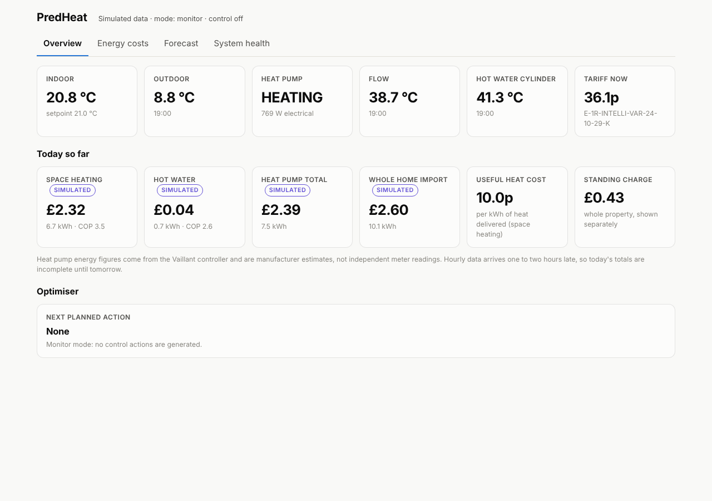
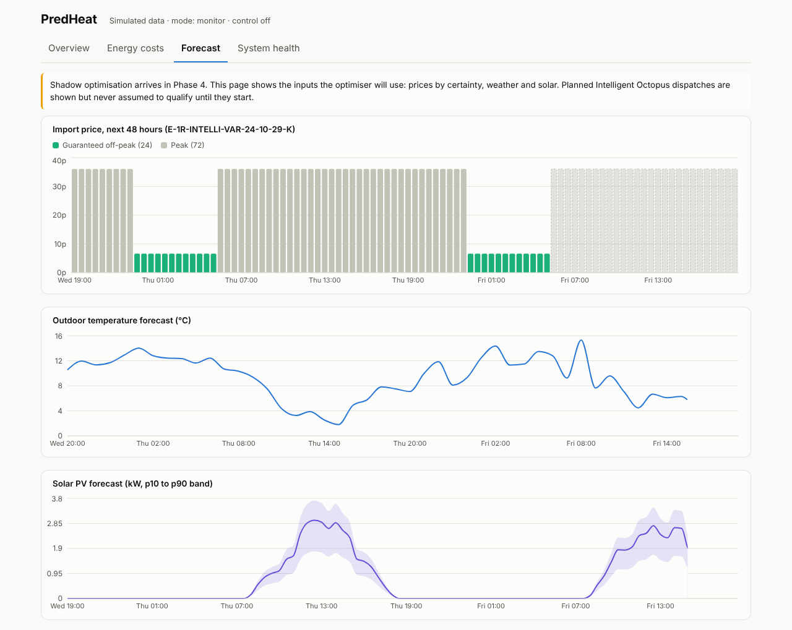

# Heat Pump Pilot

*Formerly called PredHeat. Renamed so it isn't confused with Predbat's own built-in Predheat feature; nothing about your install, settings or the `sensor.predheat_heat_pump_plan` entity changes.*

**Heat Pump Pilot watches your heat pump, learns how your house holds heat, and works out the cheapest way to keep it warm.**

It runs as a Home Assistant add-on. Give it a few days and it will tell you your home's heat loss in plain numbers, show you exactly where every kilowatt-hour went and what it cost, and lay out what it would do differently on your tariff: when to heat the hot water, when to warm the house ahead of expensive electricity, and when to let it coast.

Out of the box Heat Pump Pilot only watches and advises. Letting it move your setpoint is a separate, explicit opt-in with a guard chain around it.



## What you get

**A heat loss figure for your house.** From indoor and outdoor temperatures and the heat your pump delivers, Heat Pump Pilot fits a simple physical model and reports the heat loss in watts per degree, the equivalent kilowatts on a cold day, how many hours the house takes to cool, and how confident it is. The number improves as more days are collected.

**Where the energy went.** A flow diagram shows electricity coming in from the grid, solar or battery, the free heat the pump pulled from the outside air, and the heat that went into space heating and hot water. Costs are priced slot by slot at the tariff rate in force at the time, including Intelligent Octopus dispatch windows.

**What Heat Pump Pilot would do.** A 24-hour plan on your real prices and weather. Once the house model is learned it is a proper optimisation: every half hour's heat output chosen to minimise cost inside a comfort band, with the predicted indoor temperature drawn against a plain thermostat and the saving stated. Every line says why. In shadow mode each plan is saved and scored against what the sensors measured.

**Which tariff suits you.** Your own consumption replayed on Intelligent Go, Go, Cosy and Flexible, ranked, next to what you actually paid, and the same heat priced on gas.

**Control, when you are ready.** Switch on balanced mode, allow control and name the climate entity, and Heat Pump Pilot nudges the setpoint by up to a degree according to the plan. It hands the setpoint back on stale data, a manual change, a cold house or shutdown, and logs everything.

**System health.** Which Home Assistant entities were discovered for each signal, how fresh they are, and what is missing.



## Install

[](https://my.home-assistant.io/redirect/supervisor_add_addon_repository/?repository_url=https%3A%2F%2Fgithub.com%2Fbuildwithrhys%2Fpredheat)

1. Click the badge above, or in Home Assistant go to **Settings → Add-ons → Add-on store → ⋮ → Repositories** and add `https://github.com/buildwithrhys/predheat`.
2. Find **Heat Pump Pilot** in the store and click **Install**. The image is built on your machine and takes a few minutes.
3. On the add-on page, switch on **Show in sidebar** and, if you like, **Update automatically**, then click **Start**. Home Assistant leaves both off for every add-on.
4. Open **Heat Pump Pilot** from the sidebar.

No access token is needed. The add-on reads Home Assistant through the Supervisor.

The badge needs this repository to be public. While it is private, install from a folder instead: copy `predheat/` to `/addons/predheat` on the Home Assistant host, then refresh the add-on store and look under **Local add-ons**.

## First run

Heat Pump Pilot discovers your entities on first start and backfills a week of history. Open the **System health** tab first. It lists every signal it needs, which entity it mapped it to, and anything missing. The four signals the heat loss model cannot do without are indoor temperature, outdoor temperature, electricity used for heating and heat delivered for heating.

The heat loss figure appears once a full day of usable data exists and tightens over the following days. Until then the Overview says "Learning".

## What Heat Pump Pilot works with

Any heat pump, tariff, weather and solar source that is already in Home Assistant can be mapped. The pilot installation is a Vaillant aroTHERM via myVAILLANT, Octopus Intelligent Go via the Octopus Energy integration, OpenWeatherMap, Solcast and Huawei Solar for PV and battery. Entity names from other integrations are matched by discovery hints, and the mapping is shown on the System health tab.

## Settings

The add-on's Configuration tab holds only install-time and safety settings: data source, collection interval, log level, allow control and the climate entity. Everything you adjust while using Heat Pump Pilot, the operating mode, the setpoint offset and the gas comparison, is on the dashboard's Settings tab and applies without a restart.

- **Data source**: `home_assistant` for live data, `simulated` to explore the dashboard with a synthetic house.
- **Operating mode**: Monitor records, prices and advises. Shadow also saves every plan for scoring. Balanced and Max savings allow control, once Allow control and a climate entity are set.

Full details are in [predheat/DOCS.md](predheat/DOCS.md).

## Safety

One module can write to Home Assistant and it can do one thing: set the target of the single climate entity you name. It is loaded only when control is configured, runs a guard chain on every cycle, and cannot be enabled through the API. See [SAFETY.md](SAFETY.md).

## For developers

The repository is a Home Assistant add-on repository. `repository.yaml` marks it as such and `predheat/` is the add-on, which is also the Docker build context, so the Python package, tests and the React dashboard live inside it. The design documents are at the top level: [ARCHITECTURE.md](ARCHITECTURE.md), [DATA_MODEL.md](DATA_MODEL.md), [INTEGRATIONS.md](INTEGRATIONS.md), [VALIDATION.md](VALIDATION.md), [ROADMAP.md](ROADMAP.md).

Run it outside Home Assistant with simulated data:

```bash
cd predheat
uv venv .venv && source .venv/bin/activate
uv pip install -e ".[dev]"
pytest
predheat bootstrap          # creates data/predheat.sqlite with 14 simulated days
predheat serve              # API on http://127.0.0.1:8750, docs at /docs
cd frontend && npm install && npm run dev   # dashboard on http://localhost:5173
```

Or from the repository root, `docker compose up --build` builds the same image as the add-on and serves the dashboard on port 8750. Copy `.env.example` to `.env` to point it at a Home Assistant instance with a long-lived token.
